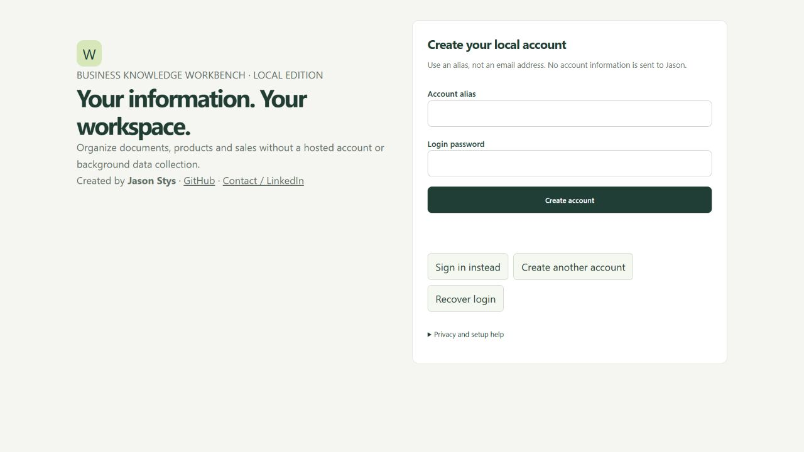
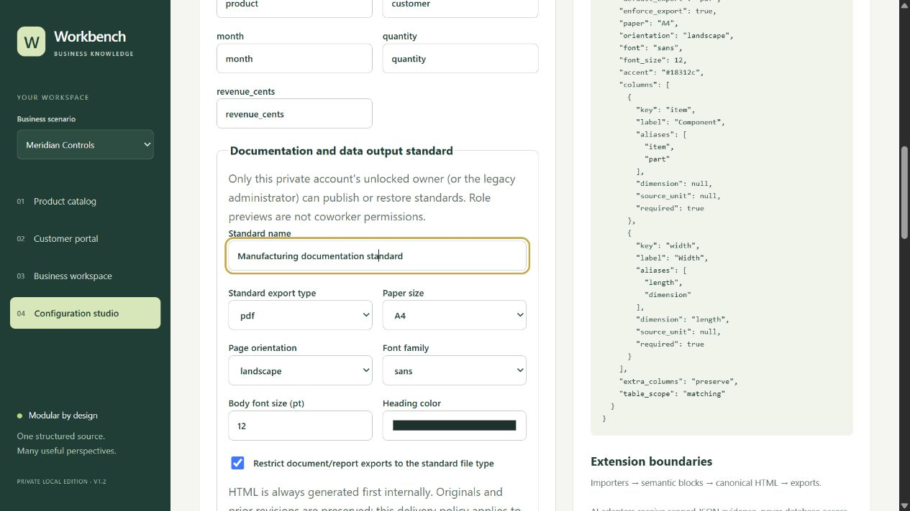

# Business Knowledge Workbench

A private, local-first **document and data standardization application** by **Jason Stys**. Its main job is to turn supported business files from different sources into a consistent, inspectable representation: common measurement units, stable field names and order, a chosen document structure and layout, and a standard output file type. Search, product views and sales graphs make that standardized information useful; they are supporting features, not the main purpose.

[Source and Actions](https://github.com/JasonStys/business-knowledge-workbench) · [Downloads](https://github.com/JasonStys/business-knowledge-workbench/releases/latest) · [Contact Jason on LinkedIn](https://www.linkedin.com/in/jason-stys-31b30b351/)

Source version **1.4.1** preserves the 1.4.0 unit-aware numeric searches and selection-based ZIP downloads with per-file integrity manifests. It corrects damaged punctuation in catalog and document-preview labels, bundles reviewed Python 3.14.10 and Electron 44.11.0 runtimes, and verifies that the same encrypted document library can be unlocked after an actual app restart. Search across saved standards without rewriting documents, then gather permitted standardized files using each document's saved output format. The visual field/layout editor, owner-controlled standards, original evidence and private local accounts remain available. See the [release notes](docs/releases/v1.4.1.md), [library guide](docs/library.md), [standards guide](docs/standards.md) and [dated workflow validation](docs/reports/practical-workflows-2026-11-09.md).



## What “standardize” means

Suppose supplier A sends a CSV field `length` containing `4.25 in`, supplier B
sends JSON with `Width: "8.2 cm"`, and a technician sends a DOCX table. The owner
defines canonical fields `item, width`, their displayed headings, order and a
millimeter target. Recognized tables then share the same schema and measurements
(`107.95 mm`, `82 mm`), even though the source files differ. Optional fields have
explicit empty cells; missing required fields, incompatible dimensions and
ambiguous duplicate headers are rejected. Extra columns can be preserved with a
warning, rejected, or explicitly omitted from standardized output. Disabled fields
are excluded even when present in a source. Original evidence remains available;
field exclusion is a presentation choice, **not redaction**.

For documents, the selected standard controls section order and headings, font,
heading color, margins, alignment, line/paragraph spacing, running headers/footers,
DOCX/PDF page numbers, Letter/A4 paper, portrait/landscape orientation and preferred
HTML/JSON/Markdown/CSV/DOCX/PDF delivery. An optional policy restricts document and
report exports to that chosen type. Every conversion still goes through canonical
HTML first. Original source bytes, pre-normalization blocks, warnings, the settings
snapshot, revision and standard digest remain available for comparison.

This is **normalization, not invention**: the app does not guess units on arbitrary
bare numbers, equate unrelated fields automatically, translate currencies or
certify that extracted facts are true. A declared table field may specify a source
unit for bare numbers. Graphs, images and equations can be retained without their
meaning being understood. See [format and fidelity limits](docs/formats.md).

## Define your business standard

1. Unlock your own private account and open **Configuration studio**.
2. Set target units, document section order/headings, standard name, print layout
   and default export type. Configure optional table keys, aliases and required
   fields in the visual editor; add, move, exclude or remove fields without writing
   JSON. The measurement-table example is an editable starting point.
3. Use **Preview draft standard** with a CSV sample or a supported source file. This does not publish
   anything, call an AI provider or alter stored documents.
4. **Save validated configuration** publishes a new revision. A stale editor gets
   a conflict instead of overwriting someone else's newer revision.
5. Import supported files or combine authorized documents. Open the result and
   choose **Download standard…**. Reports also have a standard-format download.
6. For an older document, choose **Create current-standard copy**. Originals and
   sales remain unchanged. **Restore as new revision** recovers a saved standard
   without rewriting its history or prior documents.

## Browse, search and download

Open **Business workspace** to see permitted standardized files, source types,
extraction warnings, timestamps and standard revisions. **Preview** shows canonical
HTML; **Download** in each row saves that document's standard format. The detail
view also offers original source and permitted alternate exports.

Search standardized text and titles, then combine category, source format, content
kind, measurement dimension, access scope and extraction-review filters. To locate
a specific quantity, select a canonical **Table field** such as `width` and enter
`107.95 mm` in **Field contains**. The value must occur in that same table column.
Results, counts and suggestions all obey the same permissions. Twenty-five files
appear per page, up to the 200-document profile limit. See [library examples and
limits](docs/library.md); images are not automatically OCR-searched.

For a range, choose `width`, **Minimum** `100`, **Maximum** `110` and comparison
unit `mm`: both `107.95 mm` and `10.795 cm` match, including files saved under
older standard revisions. Text and numeric conditions must hold in the same cell.
Unitless comparison never guesses units; incompatible, unknown and absent values
do not match. Temperature bounds convert with offsets, not just scale factors.

Select up to twelve files across result pages and choose **Download selected
files (ZIP)**. Each export uses its own saved standard, even when current settings
have changed. `manifest.json` records selection order, file sizes, SHA-256 hashes
and standard revisions/digests. Authorization checks every selected document
before generating anything. The ZIP contains plaintext standardized outputs,
excludes original attachments, and is not an encrypted or digitally signed archive.



The screenshot shows a published PDF/A4/landscape standard and its saved schema;
no real account credentials, documents or provider keys are included.

Authority is enforced on the server, not just by hiding a button. In the installed
private edition, the signed-in, vault-unlocked account owner is the standards
authority for their own data. There are **no shared-business invitations or
delegated coworker roles** yet. Customer/employee screens are own-account previews;
in the separate legacy role demo, only the database-authenticated administrator
may preview, publish, read history or restore standards. A client-supplied role
header cannot promote a legacy employee or customer. A responsible standards
manager would need a trusted shared-team authorization deployment, not a UI toggle.

## Install and start

Download a release for your OS, verify its SHA-256 record and launch the app. The Windows per-user setup is one click; a portable ZIP is also provided. macOS arm64 and Linux x64 packages are available. Native packages include Python, the document service and the UI—no terminal setup is needed for normal use. Builds are **unsigned / not notarized**; no claim of store approval or universal hardware support.

Choose **Open local website** from the desktop menu to use the same app in a browser. The service binds only `127.0.0.1` on an automatically selected port. There is no public hosted website, paid hosting, telemetry or Jason-operated account server. A phone cannot connect to another device's loopback address; this release has responsive web layouts, not native mobile installers.

Create an alias and login password, privately save the once-shown login recovery code, then choose a **different vault phrase**. Forgotten vault phrases cannot be recovered or reset by Jason. See [private accounts and user guide](docs/private-accounts.md).

## Main features

- Fifteen supported extensions: text, Markdown, sanitized HTML, CSV/TSV, JSON, XML, DOCX, XLSX, PDF and raster images. Original evidence, semantic blocks, extraction warnings and hashes are retained.
- Canonical **HTML first**, then HTML, JSON, Markdown, CSV tables, DOCX or PDF export. Graphs/images are preserved where supported, not universally understood; read the [format limits](docs/formats.md).
- Decimal-based measurement normalization with dimension validation; `4.25 in → 107.95 mm`, `104 F → 40 C`. Configuration revisions preserve provenance.
- Bounded signed/scientific measurement notation is normalized as a complete number; an exponent suffix cannot be mistaken for a separate measurement (`5e-3 V → 5 mV` with a millivolt standard). Embedded identifiers and ambiguous hyphenated ranges are preserved for review.
- Numeric table-field range search across compatible units and saved revisions, plus bounded multi-file ZIP exports with independent per-file integrity records. Customer subsets obey the same server permissions as individual downloads.
- Named, data-only standards with visual field addition/removal/order/exclusion, optional/required columns, explicit measurement dimensions, real-file draft previews, immutable history and controlled export types. Bounded Word-like layout settings; no executable user templates or arbitrary CSS.
- Product catalog, customer subset preview, business reporting and administrator configuration views. These are previews within **your own** account, not a coworker invitation or shared-tenant permission system.
- Explicit opt-in fictional industrial equipment, renewable energy and laboratory supply scenarios. New accounts start with **no products, sales, sources or demo users**.
- Search, filtering, sort, ordered internal-only compilations, atomic sales imports with duplicate prevention, exact-cent reports, accessible graphs and labeled baseline forecasts.
- Optional read-only AI: offline extractive reference by default; explicitly connect an own local OpenAI-compatible server or the official HTTPS chat endpoint. Own keys are encrypted with documents when locked, never returned to the UI. External source transmission requires consent for the selected destination revision.
- Real local login, scrypt password hashes, expiring HttpOnly cookies, same-origin/custom-header request gates, separate session vault proof, human-idle locking, encrypted snapshots, login recovery and current-password-confirmed own-account deletion.
- Same-origin scripts, no third-party assets or ad integrations, scriptless document previews and sandboxed native renderer with no Node/preload privileges. These controls do not defeat malware or a compromised OS/browser extension.

## Privacy and practical limits

Each account's locked document database and model settings are stored in an AES-256-GCM archive outside Git and installation files. While unlocked, the trusted local service temporarily uses plaintext files and an in-memory key. The OS owner/administrator or malware can inspect active data; this is **not zero-knowledge or protection from a compromised device**. Jason has no app backdoor or automatic remote data access.

Lock or sign out before switching accounts. Save an encrypted snapshot, then close the application before backing up the **entire** private account directory. A downloaded snapshot alone lacks account/key configuration. Plaintext exports and old developer/demo databases need separate protection. Existing demo/legacy data is neither imported nor erased.

Supported uploads are bounded to 4 MiB and 200 documents per business profile. Parsing uses timed credential-stripped child processes, not an antivirus or complete OS exploit sandbox. Do not upload files from untrusted attackers on a sensitive workstation; hostile-parser containment/CDR and shared business hosting need a separate deployment design. There is one unlocked account engine at a time. See [architecture decision](docs/adr-private-local.md), [security policy](SECURITY.md) and [release checklist](docs/release-checklist.md).

Hosted model providers can retain deliberately transmitted content under their policies. Official chat requests set `store: false`; that is not a promise of zero provider retention. No live API keys or paid model calls are required by the test suite.

## Run from source

Developer setup requires Node 24 and Python 3.12–3.14:

```powershell
python -m venv .venv
.venv\Scripts\python.exe -m pip install -r requirements.lock -e .
npm ci
npm run build
.venv\Scripts\python.exe -m server.private_cli
```

The CLI opens the local account website. Keep its process running. A trusted operator can set `KBW_ACCOUNT_DATA` to a dedicated empty test directory; never point it at unrelated files. The [legacy synthetic demo](docs/legacy-demo.md) is separate and requires explicit `KB_LEGACY_MODE=1` and `KB_DEMO=1`; never expose it to real records. Docker is optional for demo CI, not required by the installed app.

## Tests and documentation

```powershell
.venv\Scripts\python.exe -m ruff check server scripts tests/python
.venv\Scripts\python.exe -m ruff format --check server scripts tests/python
npm run format:check
.venv\Scripts\python.exe scripts/code_index.py --check
.venv\Scripts\python.exe scripts/file_catalog.py --check
.venv\Scripts\python.exe -m pytest -q
npm run build
npx playwright install chromium firefox webkit
npm test
npm run test:private
npm audit --audit-level=high
.venv\Scripts\python.exe -m pip_audit -r requirements.lock
```

[Current validation](docs/validation-v1.3.md), [prior validation](docs/validation-v1.2.md), [industry cases](examples/industry-cases.json), [standards test plan](docs/standards.md#verification) and [private API](docs/private-api.md) distinguish actual conversions/browser/native tests from provider mocks and unsupported deployments. CI retains logs; large Actions artifacts are **opt-in** through `KBW_UPLOAD_CI_ARTIFACTS=true`. Tested downloads go to Releases instead of consuming Actions artifact quota.

## File responsibilities and language choices

| Area                                                              | Responsibility                                                                                                    |
| ----------------------------------------------------------------- | ----------------------------------------------------------------------------------------------------------------- |
| `web/main.ts`, `types.ts`, `style.css`, `index.html`              | Typed document/product/reporting views, accessible HTML, responsive styling and escaped rendering.                |
| `web/private.ts`                                                  | Account forms, browser key derivation, help, own AI settings, consent and human-activity signals.                 |
| `server/accounts.py`, `permissions.py`, `vault.py`                | Local authentication/session/recovery hashes, dedicated OS-user permissions and streamed authenticated snapshots. |
| `server/private_api.py`, `private_workspace.py`, `private_cli.py` | Exact-loopback boundary, account-isolated document engine, serial lifecycle/idle recovery and local launch.       |
| `server/app.py`, `models.py`, `store.py`, `schema.sql`            | Preserved business API, validation, relational integrity, scoped searches and synthetic seeding.                  |
| `server/conversion.py`, `worker.py`, `units.py`                   | Supported rich-format parsers, bounded child conversion and exact normalization.                                  |
| `server/standards.py`, `web/standards.ts`                         | Deterministic field/schema mapping, standard fingerprints and safe typed editor controls.                         |
| `server/library.py`, `web/library.ts`, `web/standard-builder.ts`  | ACL-first filtered searches, bounded file pages and visual field-definition editing.                              |
| `server/exports.py`, `analytics.py`, `ai.py`                      | HTML-derived exports, explainable reporting and read-only model contracts.                                        |
| `desktop/main.cjs`                                                | Electron shell with an owned frozen service, denied external navigation/popups and graceful sealing.              |
| `scripts/`                                                        | Frozen entry, licenses/checksums, fixture/benchmark and exact line/file inventories.                              |
| `tests/`, `playwright*.config.ts`                                 | Real parser/API/crypto/role regressions, browser journeys and native packaged-app tests.                          |
| `public/`, `examples/`                                            | Shell-only legacy PWA assets and clearly fictional sample evidence; no user data.                                 |
| `.github/workflows/`, root configuration                          | Reproducible dependency/build/CI/package/release gates and optional legacy container.                             |
| `docs/`                                                           | Usage, limits, architecture, contracts, validation/release evidence and per-file/source maps.                     |

Python uses its mature document ecosystem, TypeScript provides typed browser interactions, SQL provides transactional business persistence, HTML/CSS keep outputs inspectable, and JavaScript powers the isolated desktop shell. [The complete file catalog](docs/file-catalog.md) summarizes each tracked file; [the generated code index](docs/code-index.md) maps every authored code file's functions/classes/variables to exact lines. Regenerate inventories after source edits.

## Documentation editions

Start with the [organized handbook](docs/handbook.md) for current usage, design, security and test guidance. Reviewed downloadable editions: [project-guide.docx](docs/reports/project-guide.docx) · [validation-review.docx](docs/reports/validation-review.docx) · [validation-evidence.xlsx](docs/reports/validation-evidence.xlsx).

[Publication identities and source scope](docs/reports/publications.json) · [Documentation validation record](docs/reports/documentation-refresh-2026-11-09.md). Historical results retain their own tested revision and date.

## Current Windows application guide

The [version 1.4.1 illustrated guide](docs/reports/windows-application-guide-1.4.1.docx) explains the actual
installed application with two real screenshots, a worked user workflow, important
source excerpts and observed validation. Read the [dated delivery report](docs/reports/installed-windows-2026-11-10.md)
and [byte and page review](docs/reports/windows-application-guide-1.4.1.json) for exact scope. Historical Office
editions remain available with their original baselines.

New documentation files:

- [docs/reports/windows-application-guide-1.4.1.docx](docs/reports/windows-application-guide-1.4.1.docx): Individually reviewed four-page installed application guide with actual screenshots, worked workflow, immutable source excerpts and limits.
- [docs/reports/windows-application-guide-1.4.1.json](docs/reports/windows-application-guide-1.4.1.json): Exact Word, actual screenshot and reviewed page digests plus observed source-specific validation results.
- [docs/screenshots/installed-1.4.1/native-workspace.png](docs/screenshots/installed-1.4.1/native-workspace.png): Actual installed application synthetic-profile screenshot: Installed standardized document library.
- [docs/screenshots/installed-1.4.1/native-standard-preview-viewport.png](docs/screenshots/installed-1.4.1/native-standard-preview-viewport.png): Actual installed application synthetic-profile screenshot: Actual custom standard preview.
